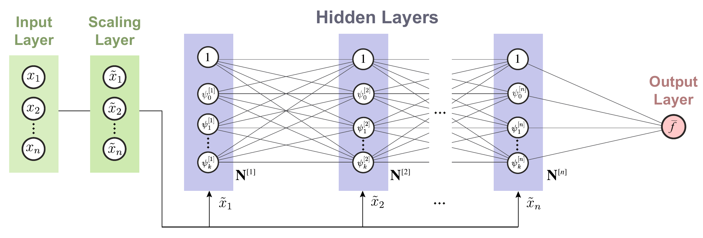
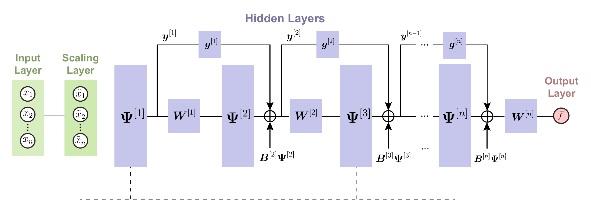
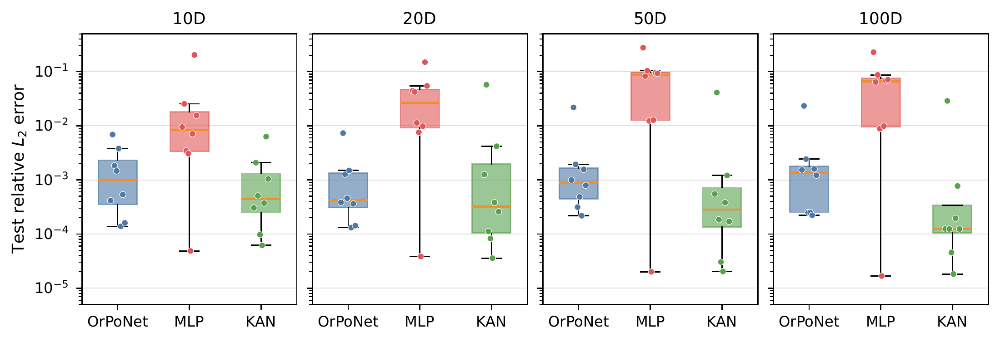
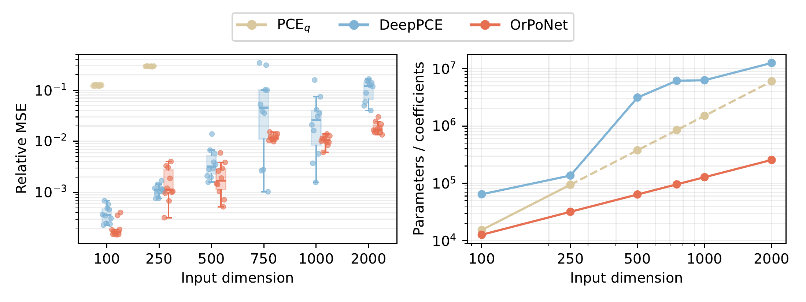
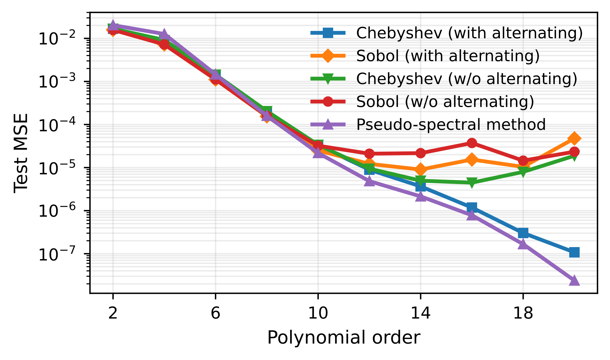

# OrPoNet: Orthogonal Polynomial Networks

**OrPoNet: An Interpretable and Scalable Neuralization of Polynomial Expansions**

This repository contains the core PyTorch implementation of OrPoNet and selected
examples from the paper.

## Quick start

Run from the repository root:

```sh
conda create -n orponet python=3.11
conda activate orponet
python -m pip install -r requirements.txt
python -m ipykernel install --user --name orponet --display-name "Python (OrPoNet)"
python -m jupyterlab
```

Select **Python (OrPoNet)** and run each notebook from the folder containing it.

## Examples

Start with the [2D toy example](function_approximation/toy_example.ipynb).

| Topic | Notebooks |
|---|---|
| Function approximation | [High-dimensional functions](function_approximation/high_dimensional_functions.ipynb) · [Bratley](bratley/bratley.ipynb) |
| Sensitivity analysis | [Sobol indices](sobol/sobol_sensitivity.ipynb) |
| PINNs | [Brusselator](pinns/brusselator.ipynb) · [20D Poisson](pinns/poisson_20d.ipynb) · [Order convergence](pinns/brusselator_order_convergence.ipynb) |

<details>
<summary>More examples</summary>

- [Coefficient recovery](appendix/coefficient_recovery.ipynb)
- [Sampling methods](appendix/sampling_methods.ipynb)
- [Spectral convergence](appendix/spectral_convergence.ipynb)
- [Copy ablation](appendix/copy_ablation.ipynb)
- [Coordinate ordering](appendix/coordinate_ordering.ipynb)
- [Nonsmooth functions](appendix/nonsmooth_functions.ipynb)

</details>

## Architecture

**OrPoNet**

After input scaling, the network introduces one coordinate at a time through its
univariate polynomial basis. Weighted features from earlier coordinates are
multiplied elementwise by the new basis, building multivariate interactions layer
by layer. A linear output combines these features, preserving an explicit
polynomial representation for coefficient and sensitivity analysis.

For one copy, forward propagation is

$$
\begin{aligned}
\boldsymbol{y}^{[1]} &= \boldsymbol{\Psi}^{[1]}(\tilde{x}_1), \\
\boldsymbol{y}^{[i]} &= \boldsymbol{\Psi}^{[i]}(\tilde{x}_i)
  \odot \left(\boldsymbol{W}^{[i-1]}\boldsymbol{y}^{[i-1]}\right),
  \qquad i=2,\ldots,n, \\
\hat{f}(\boldsymbol{x}) &= \boldsymbol{W}^{[n]}\boldsymbol{y}^{[n]}.
\end{aligned}
$$

Here $\boldsymbol{\Psi}^{[i]}$ is the basis vector for scaled coordinate
$\tilde{x}_i$, $\boldsymbol{W}^{[i]}$ contains trainable weights, and $\odot$
denotes Hadamard (elementwise) multiplication. Multiple copies propagate independently
and are combined at the output.



**Residual OrPoNet**

Residual OrPoNet adds skip connections and additive polynomial branches to the
multiplicative update. The skip paths carry earlier features forward, while the
additive branches introduce the current coordinate's basis directly. These extra
paths help train deeper networks while preserving the polynomial representation.



## Theoretical results

- **Universal approximation (Theorem 1).** With sufficient polynomial degree and
  copies, OrPoNet can uniformly approximate any continuous function on a compact
  domain to arbitrary accuracy. The proof constructs an exact OrPoNet
  representation of any finite orthogonal-polynomial expansion.
- **Tensor-train connection (Proposition 1).** Vanilla OrPoNet admits a constrained
  functional tensor-train representation. Its functional cores are constrained by
  the polynomial basis structure, while the layer widths and copy count determine
  bounds on the tensor-train ranks.

## Selected results

**Function approximation (10D–100D)**

OrPoNet has lower median errors
than MLP at all four dimensions, while KAN has lower median errors than OrPoNet.



**Bratley benchmark (100D–2000D)**

OrPoNet uses fewer trainable parameters than
DeepPCE and achieves lower mean errors at five of six tested dimensions. 



**Spectral-like convergence**

With Chebyshev collocation and alternating Adam/L-BFGS, OrPoNet follows a decay trend similar to the pseudo-spectral reference. 



## Citation

If you use OrPoNet in your research, please cite:

```bibtex
@article{xing_orponet,
  author = {Xing, Siyuan and Tartakovsky, Daniel M.},
  title = {{OrPoNet}: An Interpretable and Scalable Neuralization of Polynomial Expansions},
  journal = {Journal of Computational Physics},
  note = {Accepted for publication}
}
```

## License

[MIT](LICENSE).
